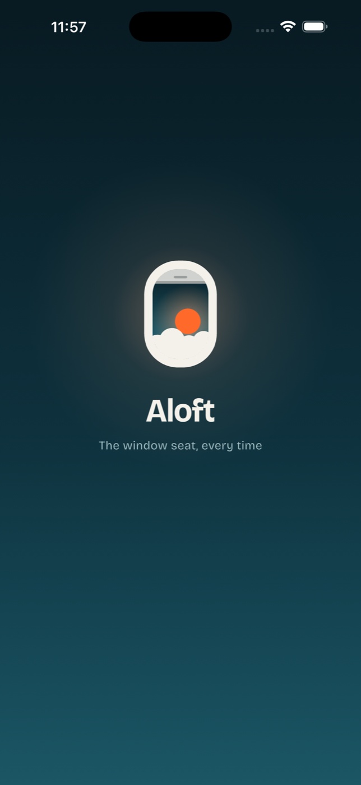
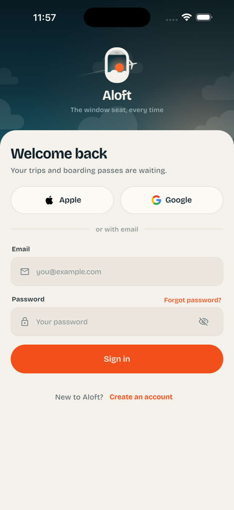
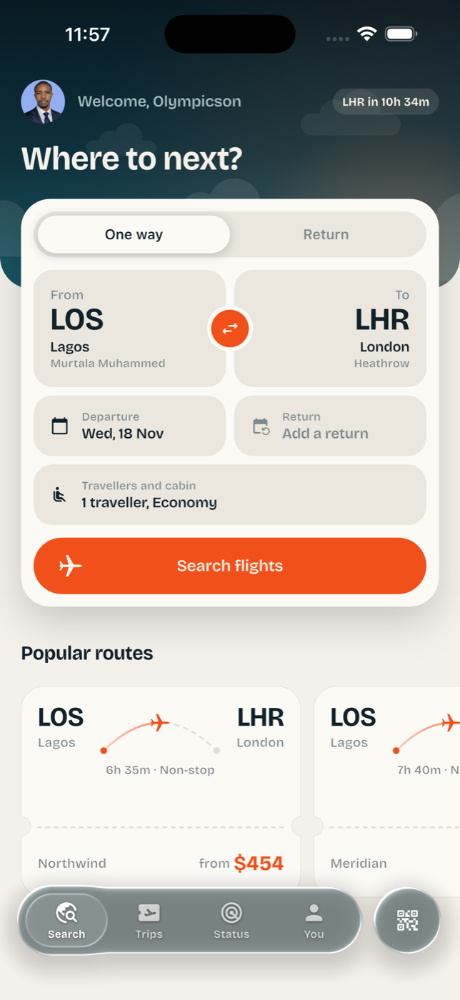
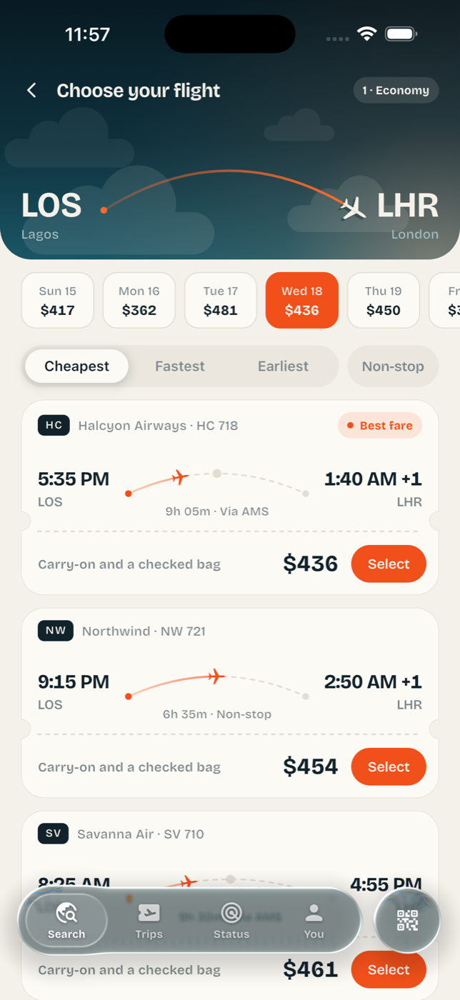
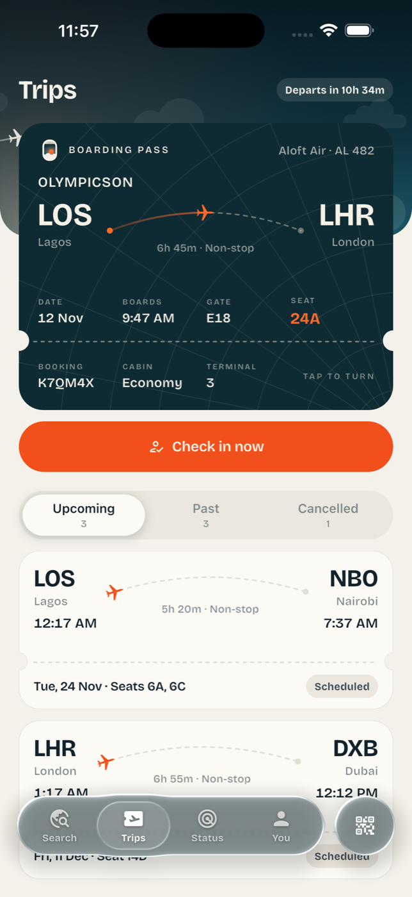
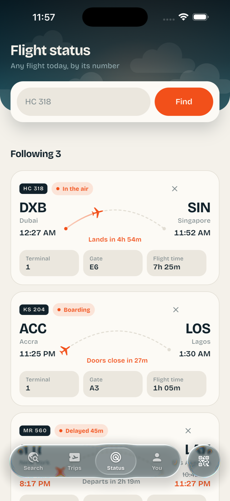

<p align="center"></p>

# Aloft

A flight booking app template in Flutter. It opens on an aircraft window whose
shade lifts on a sunrise, then flies you through the glass into the app.
Search, book, check in, carry your boarding pass and follow flights live.

    

<p>
     
</p>

## Highlights

- **A splash that is the logo coming alive.** The window frame is traced, the
  shade lifts, the sun rises over the cloud, the name rises letter by letter,
  and the camera goes through the glass onto the first screen. One timeline,
  one painter, no images.
- **A sky that is one place.** The same slow sky (drifting cloud banks, a
  plane crossing with its trail) sits behind sign-in and every header, in
  step, so screens hand over instead of cutting.
- **Planes that fly real paths.** While a search loads, a plane flies the
  route across the header and lands as the flights rise in. On the status
  tab each followed flight's plane is where it really is on its arc.
- **A boarding pass that behaves like one.** It feeds out of a printer in
  three pulls when you book, turns over in 3D to its barcode when you check
  in, and is one tap away from the glass tab bar on every screen.
- **Every colour in one file.** `lib/config/palette.dart` holds light and
  dark. A test fails if a colour is written anywhere else.
- **Everything works.** Search any pair of airports on any day, one way or
  return, pick seats, pay, cancel with undo, follow flights, manage
  travellers and cards, change your photo. Light and dark.

## Screens

| Screen | What it does |
|---|---|
| Splash | The window logo animates in, then opens onto the app |
| Sign in, create account | Apple, Google, email; reset password; named errors |
| Search | From and to with a swap, dates, travellers and cabin, recent searches, popular routes |
| Results | Fares for nine days, sort by price, time or departure, non-stop only |
| Review and pay | Seats per traveller, who is flying, card, total |
| Booked | The pass prints; a return gives two |
| Trips | Next pass with check-in, then upcoming, past and cancelled |
| Trip | Pass, the day as a timeline, details, change seats, follow, cancel |
| Status | Look a flight up by number, follow flights, unfollow with undo |
| You | Photo, details, what you have flown, travellers, cards, appearance, reset, sign out |

## Try the demo

- Sign in with any email and any password of six characters or more. You
  arrive as Olympicson. The password `wrongpass` shows the wrong-password
  state.
- The next trip, Lagos to London, leaves in 10 hours 35 minutes whenever you
  open the app, so check-in is always open. Tap **Check in now**.
- Search **Lagos to Sydney** and switch on **Non-stop** to see an empty
  result that explains itself.
- Pay with the card ending **0002** to see a declined payment.
- On Status, find `SV 409` (cancelled), `MR 560` (delayed) or `HC 318` (in
  the air). `ZZ 999` is not a flight.
- **You, Reset demo data** puts everything back.

## Getting started

```bash
flutter pub get
flutter run
```

Flutter 3.38 or newer. The glass tab bar and the booking transition use
fragment shaders and need Impeller, the default on iOS and Android.

## Make it yours

| To change | Edit |
|---|---|
| Every colour, light and dark | `lib/config/palette.dart` |
| The name and tagline | `lib/config/app_brand.dart` |
| Type scale and font | `lib/config/app_theme.dart`, `assets/fonts/` |
| How long things wait (splash, search, payment) | `lib/config/app_timing.dart` |
| How things move | `lib/config/motion.dart` |
| Airports, airlines, popular routes | `assets/data/airports.json`, `airlines.json`, `routes.json` |
| The demo person, trips, live flights | `assets/data/profile.json`, `trips.json`, `live.json`, `travellers.json`, `cards.json` |
| The logo | `lib/widgets/aloft_mark.dart`, then the two commands below |
| A real backend | `lib/providers/core_providers.dart` |

After changing the logo or the palette, redraw the app icon from the same
painter:

```bash
flutter test test/tool/render_brand_test.dart
python3 tool/make_icons.py
```

### Connecting a backend

Screens only talk to four repositories (`lib/services/`): flights, trips,
account and auth. Each file ends with a commented `Remote...` class showing
the network version. Return those from `lib/providers/core_providers.dart`
and nothing else changes: the seed files already use the JSON shapes the
models parse.

Flight times are stored in UTC and shown on each airport's own clock.
Seeded trips and live flights are written as minutes from launch, which is
why there is always one about to leave and one in the air.

## Project structure

```
lib/
  config/      palette, theme, brand, motion, timing, launch hooks
  models/      flight, trip, airport, account, money, dates
  services/    repositories, seed loader, storage, media
  providers/   Riverpod state: session, trips, search, account
  widgets/     logo, plane, sky, route arc, ticket shapes, loader
  screens/     splash, auth, shell, home, search, booking, trips, status, profile
  kit/         glass tab bar, pay button, shader route, particles
assets/data/   the demo data, one JSON file per entity
test/          131 tests
```

## How it is built

- **State:** Riverpod. Anything that can be derived is derived (a flight's
  phase, the three trip lists, travel stats), so two screens cannot disagree.
- **Motion:** each animation is one controller read directly by a painter,
  inside a repaint boundary. Nothing rebuilds per frame. Skies stop ticking
  when their tab is hidden, and everything honours reduce motion.
- **Storage:** `shared_preferences` for what the person changes, on top of
  read-only seed JSON. No card number is ever stored: brand, last four,
  expiry and holder only.

## Testing

```bash
flutter analyze
flutter test
```

Widget tests cover every screen at phone size, including the empty, error
and declined states, plus the timetable, the trip repository and the photo
storage rules.

## Made by FlutterZip

[flutterzip.com](https://flutterzip.com) · Instagram [@flutter_zip](https://instagram.com/flutter_zip)

## Credits

- Bricolage Grotesque, SIL Open Font License (`assets/fonts/OFL.txt`).
- The logo, plane, sky, tickets and barcode are drawn in code.
- Airline names are invented. Airport names and codes are real.

## License

MIT. See [LICENSE](LICENSE).
